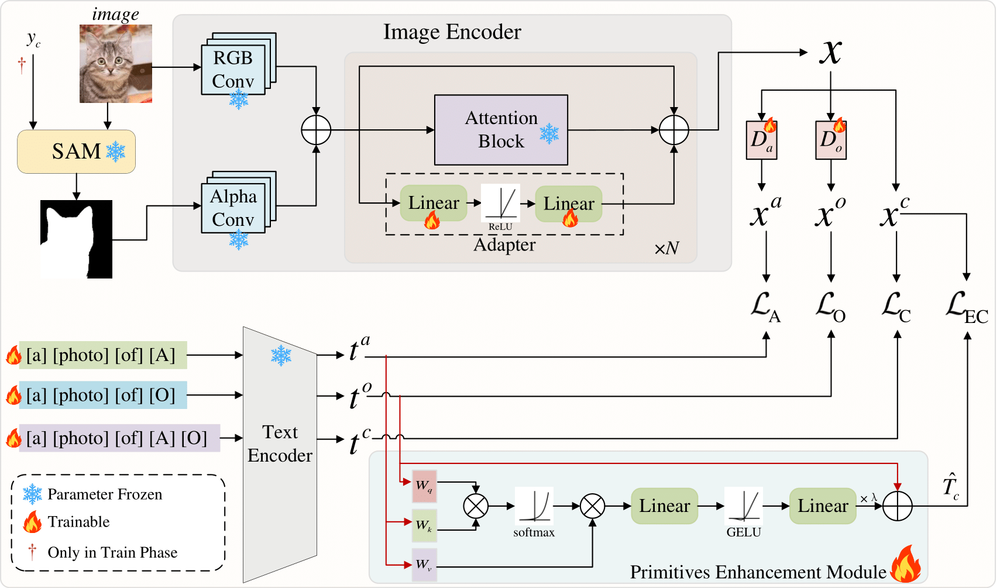
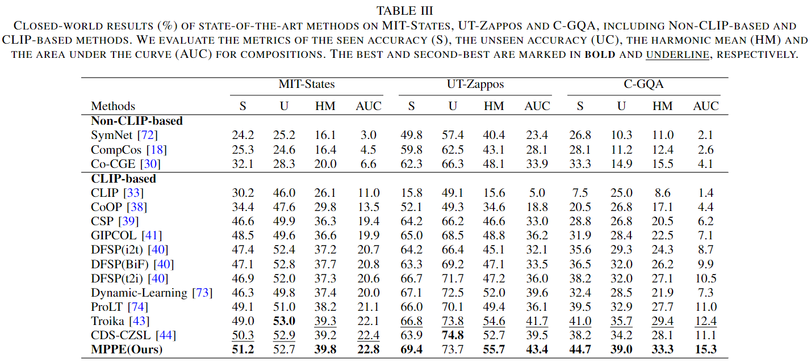
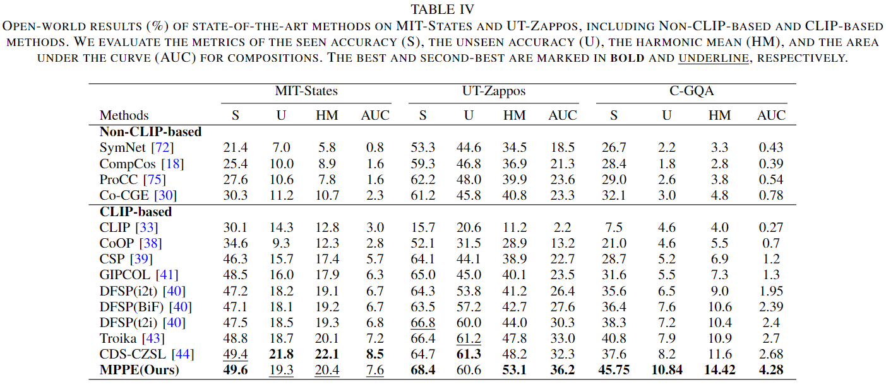
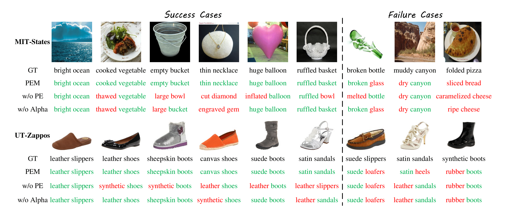
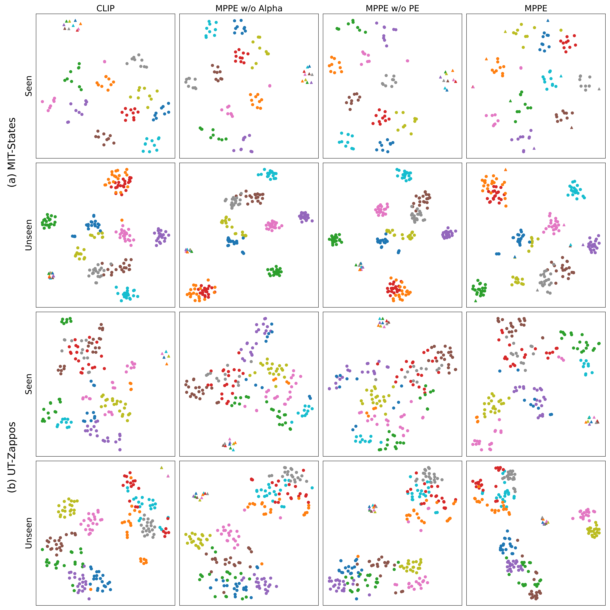

# MPPE
- **Title: Multi-modal Prompts with Primitives Enhancement for Compositional Zero-Shot Learning （MPPE）**
- **Authors: Yutang Jin, Shiming Chen, Tianle Tong, Weiping Ding, Yisong Wang.**
- **Institutes: Guizhou University, Huazhong University of Science and Technology, Nantong University.**

This paper is accepted by TCSVT. The early access version: [PDF](https://ieeexplore.ieee.org/document/11027124)

## Overview
<p align="center">
  
</p>

The overview of the proposed MPPE model. MPPE is based on CLIP, with two primitive prompts and one compositional prompt, which are totally learnable. Additionally, a visual prompt named Alpha branch is introduced to help focus on regions of interest, by binary masks from SAM model with corresponding object label, especially, $\color{red}\dagger$</font> denotes the label is only used in the training phase. Another main part of our work is the primitives enhancement module(termed as PE), primitive semantic features from text encoder are fed into PE to generate enhanced compositional semantic features, as an extra compositional prediction branch. Specifically, the primitives enhancement module is based on cross-attention, object and attribute semantic features $t^{o}$ and $t^{a}$ are fed into and as query and key, value respectively, followed with nonlinear transformations, finally the enhanced compositional semantic features $\hat{T_{c}}$ is generated. Additionally, a learnable coefficient $\lambda$ is included for controlling the weight of enhanced compositional semantic features.

## Results
### Main Results
The results in CW-CZSL and OW-CZSL settings. More implementation details are illustrated in the paper.
<p align="center">
  
</p>
<p align="center">
  
</p>

### Qualitative Results
<p align="center">
  
</p>

Qualitative results of different architecture of our method. We evaluate top-1 predictions for some cases on the MIT-States and UT-Zappos. GT means ground truth labels, PE is the primitives enhancement module and Alpha denotes the visual prompt branch of our MPPE. $\color{green}Green$ and $\color{red}red$ denotes successful and unsuccessful predictions, respectively.

### t-SNE visualization on Two Benchmarks
<p align="center">
  
</p>

t-SNE visualization on (a) MIT-States and (b) UT-Zappos, including seen and unseen compositions. For this analysis, we selected four models: CLIP, MPPE without the Alpha branch (MPPE w/o Alpha), MPPE without the primitives enhancement module (MPPE w/o PE), and the full MPPE model. On the test sets of MIT-States and UT-Zappos, we randomly selected ten seen compositions and ten unseen compositions for visualization. In this figure, circular dots represent the visual features of image samples, while triangular markers denote text features of corresponding labels. Samples of the same composition class are indicated by identical colors.

## Usage
### Setup 
1. Clone the repo 
2. We recommend using Anaconda for environment setup. To create the environment and activate it, please run:
```
    conda env create --file environment.yml
    conda activate czsl
```
3. Go to the cloned repo (/download_data) and open a terminal. Download the datasets:
```
    sh download_data.sh
```
4. Download SAM model from [segment-anything](https://github.com/facebookresearch/segment-anything), and run:
```
    python generate_mask_code/seg_czsl.py
```
to get binary masks.

### Training
To train MPPE, the command is:
```
    python train.py --yml_path config/mppe/mit-states.yml --dataset_path datasets/mit-states --clip_arch pretrained_clip/ViT-L-14.pt --alpha_vision_ckpt_pth pretrained_alphaclip/clip_l14_grit20m_fultune_2xe.pth --save_path logs
```

### Testing a trained checkpoint

Use `test_MPPE.py` for MPPE: it uses the same `CompositionMaskDataset`
and five-element image/mask/label batches as training. Run from the repository root:

```bash
python test_MPPE.py \
  --yml_path config/mppe/mit-states.yml \
  --dataset_path datasets/mit-states \
  --clip_arch pretrained_clip/ViT-L-14.pt \
  --alpha_vision_ckpt_pth pretrained_alphaclip/clip_l14_grit20m_fultune_2xe.pth \
  --load_model logs/val_best.pt \
  --open_world false
```

- Replace `logs` with the `--save_path` used for training.
  `val_best.pt` is a plain model state dictionary selected using the YAML
  `val_metric` (AUC for the supplied MIT-States config; loss for UT-Zappos/C-GQA).
  Periodic `epoch_<i>.pt` checkpoints use zero-based epoch indices.
- Use the same model architecture, prompt settings, dataset split and inference
  weights as training. For UT-Zappos or C-GQA, use the corresponding
  `config/mppe/ut-zappos.yml` or `config/mppe/cgqa.yml`, dataset root and
  checkpoint. Strict loading rejects incompatible state dictionaries.
- Both pretrained weight paths remain necessary because the model constructor
  initializes CLIP/AlphaCLIP before loading the trained state dictionary.
  Prepare the dataset metadata, split files, `images/` and matching `masks/`
  as in training. The current loader reads mask files for all three datasets,
  including those for which it subsequently substitutes a zero mask.
- The implementation requires CUDA and the project dependencies. Adjust
  `--eval_batch_size` and `--text_encoder_batch_size` for available GPU memory.
  Explicit CLI options override YAML options in `test_MPPE.py`.

For open-world evaluation, change the last option to `--open_world true`.
This requires `data/feasibility_<dataset>.pt`, aligned with the full
attribute–object Cartesian product used by the dataset. With no `--threshold`,
the script searches `--threshold_trials` thresholds (default 50) on validation
AUC, then reuses the chosen threshold on the test set. To reuse an already
chosen threshold, pass `--threshold <value>`. Closed-world evaluation does not
require feasibility scores.

The script evaluates validation and test splits and prints metrics including
best seen/unseen accuracy, best harmonic mean and AUC. These are calibration
sweep metrics, rather than accuracy at one fixed deployment bias.
The legacy standalone `test.py` uses an unmasked dataset and should not be
used as the MPPE testing entry point.

**Validation status:** the evaluation fixes have passed Python syntax checks
and dependency-free regression checks using synthetic batches and stub models
(`python tests/test_mppe_evaluation.py`). These checks cover label indexing,
text feature caching, CLI overrides and PE/CAM config compatibility; they do
not run MPPE. Full checkpoint inference and benchmark metrics have not been
verified in this environment because PyTorch/CUDA, datasets and trained
weights are unavailable.

## Acknowledgement
This project mostly references [[Troika]](https://github.com/bighuang624/Troika) and [[DFSP]](https://github.com/Forest-art/DFSP), and I once again express my sincere gratitude to the authors of these two papers!

